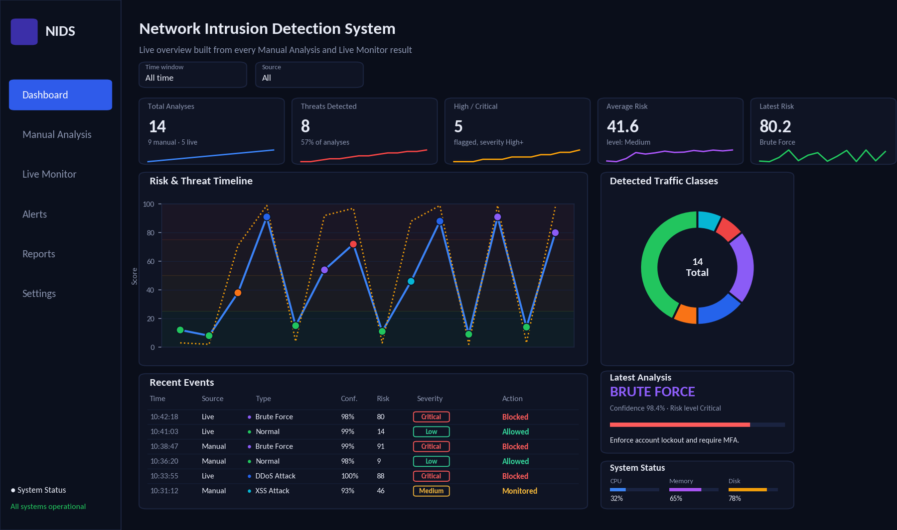
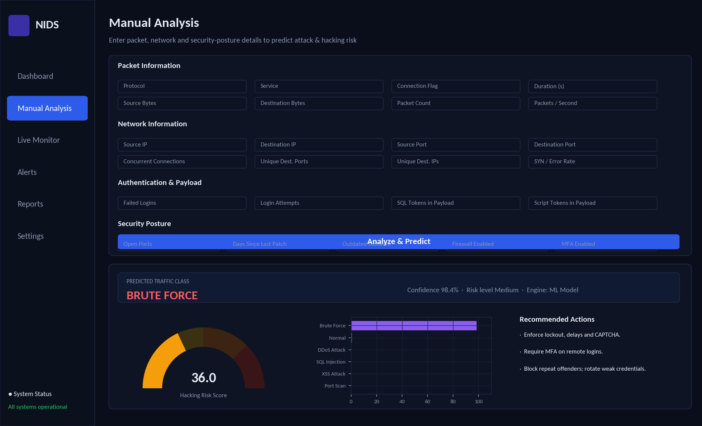
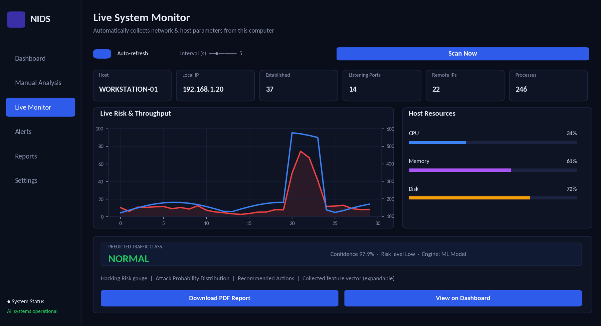
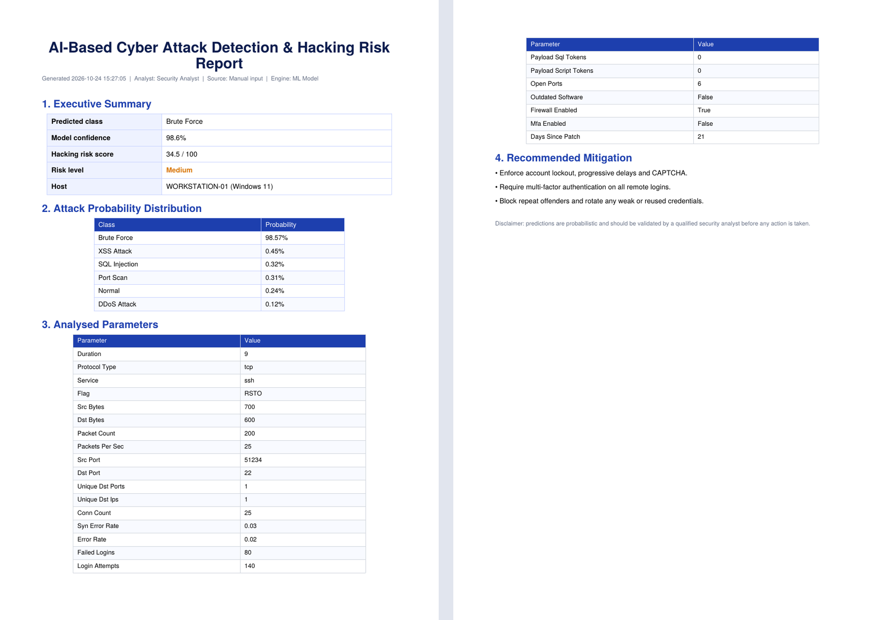
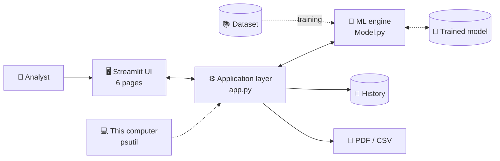
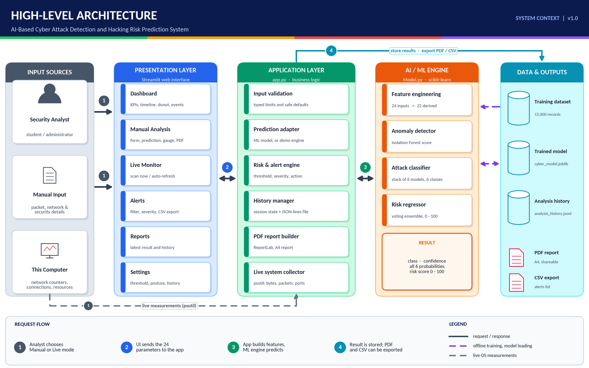
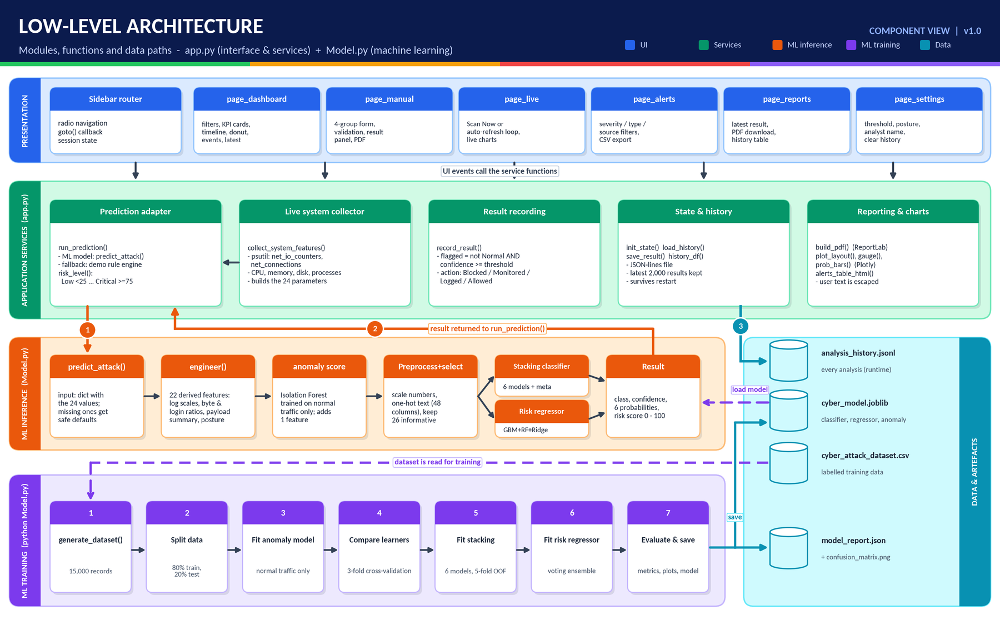
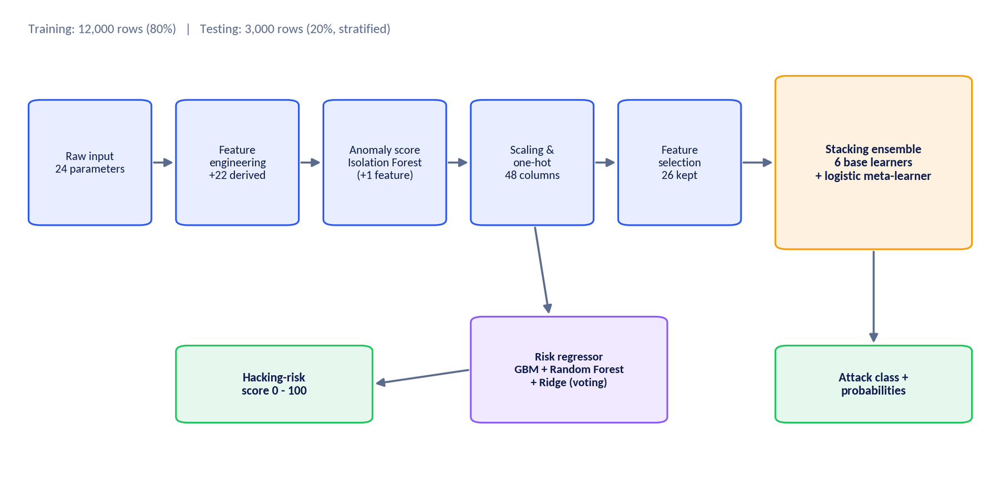
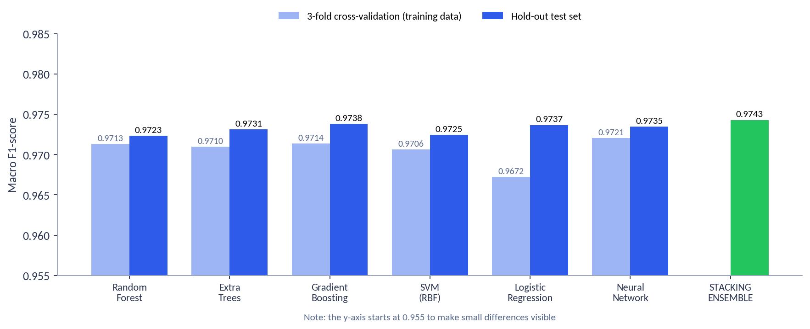
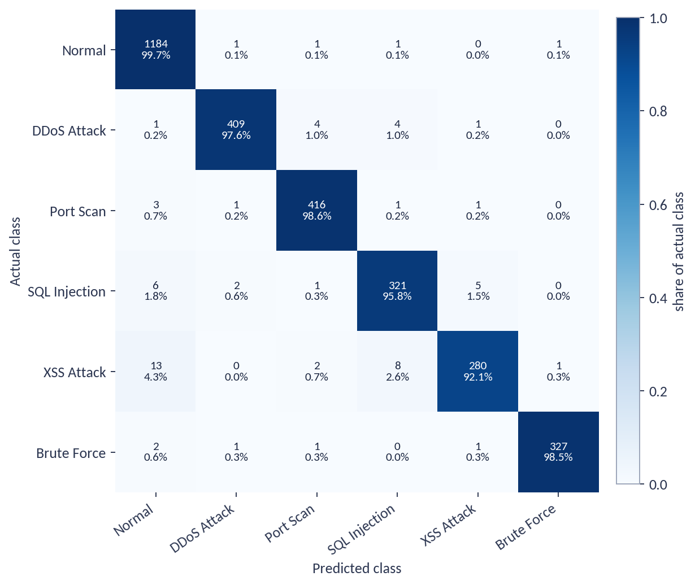

<div align="center">

# 🛡️ AI-Based Cyber Attack Detection & Hacking Risk Prediction System

**Machine-learning powered intrusion detection with a professional security-operations dashboard**

[](https://www.python.org/)
[](https://streamlit.io/)
[](https://scikit-learn.org/)
[](https://plotly.com/)
[](#-model-performance)
[](LICENSE)

[Features](#-features) • [Preview](#-preview) • [Architecture](#-architecture) • [Quick start](#-quick-start) • [Deploy](#-deploy-on-streamlit-community-cloud) • [The model](#-the-machine-learning-model) • [Documentation](#-documentation)



<sub>Illustrative rendering of the dashboard with sample data.</sub>

</div>

---

## 📖 Overview

Cyber attacks are fast and varied, while the people defending against them are few. This project turns **packet information, network information and security settings** into three things a person can act on:

1. 🎯 the **type of activity** it most resembles (Normal, DDoS, Port Scan, SQL Injection, XSS or Brute Force),
2. 📊 a **confidence value** with the probability of every class, and
3. 🔥 a **hacking-risk score from 0 to 100** that combines attack behaviour with how well the machine is protected.

It works in two ways: **Manual Analysis** (enter the details yourself) and **Live Monitor** (the app measures the computer it runs on). Every result feeds an interactive dashboard and can be exported as a professional **PDF report**.

> ⚠️ **Decision-support tool.** Labels such as *Blocked* describe the recommended response level; the app does not change firewall rules or end connections. See [Limitations](#-limitations--responsible-use).

## ✨ Features

| | |
|---|---|
| 🧪 **Manual Analysis** | Four-group form (packet, network, authentication/payload, security posture) with limits and defaults. |
| 📡 **Live Monitor** | One-click or auto-refresh scan of the local computer using `psutil`. |
| 📊 **Interactive dashboard** | KPI cards, risk timeline, class donut, events table, latest verdict; filter by time window and source. |
| 🚨 **Alerts** | Filter by severity, type and source; export to CSV. |
| 📄 **PDF reports** | A4 report with summary, probabilities, all parameters and class-specific mitigation advice. |
| 🧠 **Multi-algorithm ML** | Stacked ensemble of 6 models + Isolation Forest anomaly score + separate risk regressor. |
| 💾 **Persistent history** | Results survive a restart when run locally (session-only on hosted deployments). |
| 🛟 **Self-healing model** | If the saved model is incompatible with the installed scikit-learn, it is retrained automatically. |

## 🖼️ Preview

<table>
<tr>
<td width="50%"><br><sub><b>Manual Analysis</b> - form, prediction, gauge, probabilities</sub></td>
<td width="50%"><br><sub><b>Live Monitor</b> - automatic measurement of this computer</sub></td>
</tr>
<tr>
<td colspan="2"><br><sub><b>Generated PDF report</b> (real output of the application)</sub></td>
</tr>
</table>

> The interface images are illustrative renderings. Replace them with screenshots of your running app (keep the same file names in `docs/images/`).

## 🏗️ Architecture



<details>
<summary><b>Show the detailed architecture diagrams</b></summary>

**High-level**



**Low-level (modules and functions)**



</details>

## 🧰 Tech stack

| Area | Technology |
|---|---|
| Language | Python 3.9+ |
| Interface | Streamlit, Plotly |
| Machine learning | scikit-learn, pandas, NumPy, joblib |
| System monitoring | psutil |
| Reporting | ReportLab |

## 🚀 Quick start

**Prerequisites:** Python 3.9 or newer (64-bit).

```bash
# 1. Get the code
git clone https://github.com/<your-username>/<your-repo>.git
cd <your-repo>

# 2. Create and activate a virtual environment
python -m venv venv
venv\Scripts\activate          # Windows
# source venv/bin/activate     # Linux / macOS

# 3. Install dependencies
pip install -r requirements.txt

# 4. Train the model once (about 2 minutes) - writes cyber_model.joblib
python Model.py

# 5. Launch the app
streamlit run app.py
```

The sidebar should show **Engine: ML Model**. Skipping step 4 also works: the app trains a model automatically on first start.

<details>
<summary>Useful options for <code>Model.py</code></summary>

| Command | What it does |
|---|---|
| `python Model.py --fast` | Smaller, quicker training for a first test |
| `python Model.py --tune` | Adds a randomised hyper-parameter search |
| `python Model.py --regenerate` | Rebuilds the dataset before training |
| `python Model.py --demo` | Prints sample predictions with the saved model |

</details>

## ☁️ Deploy on Streamlit Community Cloud

1. Push this repository to GitHub (the trained `cyber_model.joblib` is intentionally **not** committed - see `.gitignore`).
2. On [share.streamlit.io](https://share.streamlit.io) choose **New app**, select the repository and set the main file to `app.py`.
3. Deploy. On the **first start the app trains the model for the server** (about 1-3 minutes, a progress message is shown); later starts are fast.

**Good to know for hosted deployments**

- 🌐 The **Live Monitor measures the server that runs the app, not the visitor's computer.** Use Manual Analysis for online demonstrations and run the app locally to monitor your own PC.
- 🔒 Analysis history is kept **per browser session only**, so visitors never see each other's data.
- 💤 The free tier restarts idle apps; the model is simply rebuilt on the next start.

## 🧭 Using the application

| Page | Purpose |
|---|---|
| **Dashboard** | Overview of all analyses with filters, KPIs, timeline, class distribution and the latest verdict |
| **Manual Analysis** | Enter details, predict, view gauge/probabilities/recommendations, download the PDF |
| **Live Monitor** | Scan this computer once or continuously |
| **Alerts** | Review and export detected threats |
| **Reports** | Latest result, PDF download and history |
| **Settings** | Alert threshold, analyst name, assumed security posture, clear history |

<details>
<summary><b>Try it: sample Brute-Force input for Manual Analysis</b></summary>

| Field | Value | Field | Value |
|---|---|---|---|
| Protocol / Service / Flag | tcp / ssh / RSTO | Failed Logins | 80 |
| Duration / Src / Dst bytes | 9 / 700 / 600 | Login Attempts | 140 |
| Packet count / per second | 200 / 25 | SQL / Script tokens | 0 / 0 |
| Source IP → Destination IP | 203.0.113.45 → 10.0.0.5 | Open ports | 6 |
| Source / Destination port | 51234 / 22 | Days since patch | 21 |
| Connections / unique ports / IPs | 25 / 1 / 1 | Outdated / Firewall / MFA | Off / On / Off |
| SYN / error rate | 0.03 | | |

Expected: **Brute Force**, confidence above 95%, risk ≈ 35 (Medium). Make the host weaker (20 open ports, patch 120 days old, outdated software on, firewall off) and the risk rises to ≈ 58 (High).

</details>

## 🧠 The machine-learning model



| Stage | Technique |
|---|---|
| Feature engineering | 24 inputs → 22 derived features (log scales, ratios, payload summary, posture score) |
| Anomaly detection | Isolation Forest trained on normal traffic only → anomaly score used as a feature |
| Preprocessing | Standard scaling + one-hot encoding (48 columns) |
| Feature selection | Extra-Trees importance (26 columns kept) |
| Classifier | **Stacking ensemble** - Random Forest, Extra-Trees, Gradient Boosting, SVM (RBF), Logistic Regression, Neural Network - combined by a logistic meta-learner (5-fold out-of-fold) |
| Imbalance handling | Balanced class weights |
| Evaluation | Stratified hold-out test set, k-fold cross-validation, ROC-AUC, log-loss, confusion matrix |
| Risk score | Voting regressor (Gradient Boosting + Random Forest + Ridge), output 0-100 |

### 📈 Model performance

Measured on **3,000 held-out records** of the synthetic dataset (15,000 records, 80/20 stratified split):

| Metric | Value |
|---|---|
| Accuracy | **97.9%** |
| Macro precision / recall / F1 | 0.9784 / 0.9705 / **0.9743** |
| ROC-AUC (one-vs-rest) | 0.9899 |
| Risk-score error (MAE) / R² | 2.44 points / 0.968 |

| Class | Precision | Recall | F1 | ROC-AUC | Test records |
|---|---|---|---|---|---|
| Normal | 0.979 | 0.997 | 0.988 | 0.995 | 1188 |
| DDoS Attack | 0.988 | 0.976 | 0.982 | 0.988 | 419 |
| Port Scan | 0.979 | 0.986 | 0.982 | 0.993 | 422 |
| SQL Injection | 0.958 | 0.958 | 0.958 | 0.991 | 335 |
| XSS Attack | 0.972 | 0.921 | 0.946 | 0.982 | 304 |
| Brute Force | 0.994 | 0.985 | 0.989 | 0.991 | 332 |

<details>
<summary><b>Algorithm comparison and confusion matrix</b></summary>

| Model | Test accuracy | Test macro F1 | 3-fold CV macro F1 |
|---|---|---|---|
| Random Forest | 0.9770 | 0.9723 | 0.9713 |
| Extra-Trees | 0.9777 | 0.9731 | 0.9710 |
| Gradient Boosting | 0.9790 | 0.9738 | 0.9714 |
| SVM (RBF) | 0.9780 | 0.9725 | 0.9706 |
| Logistic Regression | 0.9783 | 0.9737 | 0.9672 |
| Neural Network (MLP) | 0.9783 | 0.9735 | 0.9721 |
| **Stacking ensemble** | **0.9790** | **0.9743** | n/a |

All algorithms perform within about 0.2 points of each other; the stack's practical benefit is stable, well-behaved probabilities rather than a large accuracy jump.





</details>

### ✅ Scenario tests

Eight hand-built scenarios (independent of the dataset) run through the trained model:

| ID | Scenario | Expected | Predicted | Confidence | Risk |
|---|---|---|---|---|---|
| TC-1 | Secure web browsing | Normal | Normal | 98.2% | 4.3 |
| TC-2 | SYN flood, 22,000 packets/s | DDoS Attack | DDoS Attack | 97.7% | 45.3 |
| TC-3 | Sweep of 420 ports | Port Scan | Port Scan | 98.2% | 35.8 |
| TC-4 | 9 SQL tokens in payload | SQL Injection | SQL Injection | 98.4% | 51.9 |
| TC-5 | 8 script tokens in payload | XSS Attack | XSS Attack | 96.9% | 37.0 |
| TC-6 | SSH password guessing, 80 failed logins | Brute Force | Brute Force | 98.6% | 34.5 |
| TC-7 | Same attack, hardened host | Brute Force | Brute Force | 98.6% | 34.5 |
| TC-8 | Same attack, weak host (unpatched, no firewall) | Brute Force | Brute Force | 98.4% | 58.1 |

> **Honest note:** the dataset is **synthetic**. These figures show the pipeline works end to end; they are not a promise of the same accuracy on real-world traffic. To use real data (e.g. CIC-IDS2017 or NSL-KDD), map it to the 24 input columns plus `label` and `risk_score`, then run `python Model.py` again.

## 📁 Project structure

```
├── app.py                        # Streamlit interface and application logic
├── Model.py                      # Dataset generator, training, evaluation, prediction API
├── cyber_attack_dataset.csv      # Labelled dataset (15,000 records)
├── model_report.json             # Evaluation results of the reference training run
├── requirements.txt
├── LICENSE
├── .gitignore
└── docs/
    ├── Project_Documentation.docx   # Full project documentation (29 pages)
    ├── Architecture_Diagrams.docx   # High-level and low-level architecture
    └── images/                      # Figures used by this README
```

Created at runtime (git-ignored): `cyber_model.joblib`, `analysis_history.jsonl`.

## ⚙️ Settings that matter

| Setting | Default | Effect |
|---|---|---|
| Alert confidence threshold | 60% | A non-normal result is flagged as a threat only above this confidence |
| Firewall / MFA / outdated software / days since patch | On / Off / Off / 21 | Assumed security posture used by the Live Monitor |
| Risk levels | Low <25 · Medium <50 · High <75 · Critical ≥75 | Mapping of the 0-100 score |

## 🚧 Limitations & responsible use

- Trained on **synthetic data**; retrain on real labelled traffic before relying on it.
- **Six classes only**; other attack types are mapped to the closest class or to Normal.
- Live mode cannot read login logs or request payloads, so brute force, SQL injection and XSS are best investigated with Manual Analysis.
- Live mode analyses **summary statistics of a time window**, not individual packets, and very quiet windows are reported as *Normal (idle)* because there is too little traffic to judge.
- Only use it on systems you **own or are authorised to assess**. It is a defensive learning and decision-support tool, not a replacement for a firewall or professional security monitoring.

## 🩺 Troubleshooting

<details>
<summary><b>"Model error (No module named '_loss')" or the sidebar shows Demo Engine</b></summary>

The saved model was built with a different scikit-learn version than the one installed on the server. The current version detects this and retrains automatically. If you still see Demo Engine, make sure `Model.py` is in the same folder as `app.py`, delete any old `cyber_model.joblib` from the repository, and redeploy.
</details>

<details>
<summary><b>Live Monitor shows few or no connections</b></summary>

Some systems restrict the connection list. Run the terminal as administrator (Windows) or with elevated rights (Linux/macOS).
</details>

<details>
<summary><b>Dependency installation fails with "connection interrupted"</b></summary>

Unstable network or antivirus scanning a partial download. Install the packages one at a time with `pip install <package> --retries 10 --default-timeout=120`, or try another network.
</details>

<details>
<summary><b><code>streamlit</code> command not found</b></summary>

Activate the virtual environment, or start the app with `python -m streamlit run app.py`.
</details>

## 🗺️ Roadmap

- [ ] Retrain and validate on real datasets (CIC-IDS2017, NSL-KDD)
- [ ] Packet capture / flow extraction for network-wide live monitoring
- [ ] Read operating-system security logs for failed-login counts
- [ ] Per-prediction explanations and drift detection
- [ ] Firewall / ticketing integrations and multi-user accounts

## 📚 Documentation

- 📘 [Full project documentation](docs/Project_Documentation.docx) - purpose, architecture, interface guide, dataset, model, evaluation, testing, deployment
- 🧭 [Architecture diagrams](docs/Architecture_Diagrams.docx) - high-level and low-level views

## 🤝 Contributing

Issues and pull requests are welcome. For larger changes please open an issue first to discuss what you would like to change.

## 📜 License

Released under the [MIT License](LICENSE).

## 🙏 Acknowledgements & references

- Sharafaldin, Lashkari & Ghorbani (2018) - *Toward generating a new intrusion detection dataset and intrusion traffic characterization* (CIC-IDS2017)
- Liu, Ting & Zhou (2008) - *Isolation Forest*
- Wolpert (1992) - *Stacked generalization*
- Breiman (2001) - *Random Forests*
- Pedregosa et al. (2011) - *Scikit-learn: Machine learning in Python*
- NIST SP 800-94 - *Guide to Intrusion Detection and Prevention Systems*

<div align="center">

⭐ If you find this project useful, consider giving it a star.

</div>
